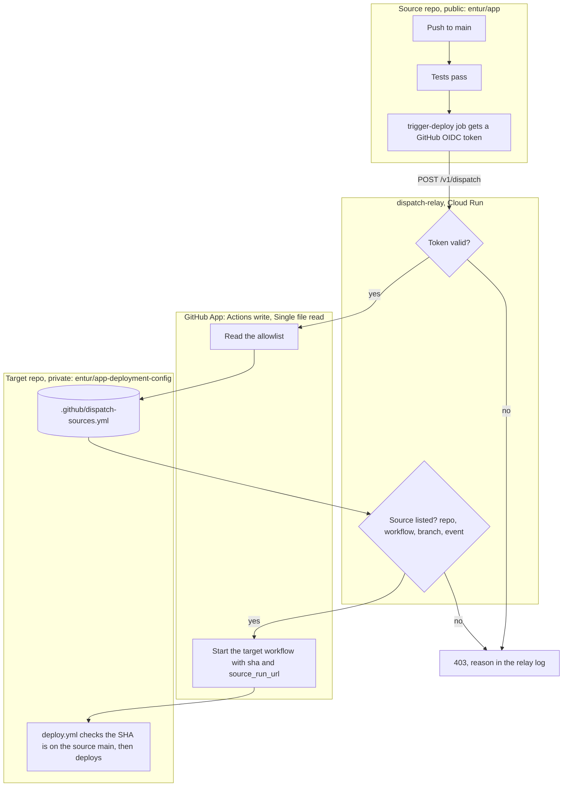

# dispatch-relay

Lets a public repo trigger a deploy workflow in a private repo without a secret. The source workflow sends its
GitHub OIDC token; the relay verifies it, checks the target's `.github/dispatch-sources.yml`, and dispatches the
target workflow as a GitHub App, with `sha` and `source_run_url` taken from the token. The design and threat model
are in [docs/design.md](docs/design.md).



## How it works

1. A push to `main` in the source repo runs its workflow, and the tests pass.
2. The `trigger-deploy` job, the only job with `id-token: write`, asks GitHub for an OIDC token with audience
   `entur-dispatch-relay`. GitHub signs it; it names the repo, workflow, branch, event, commit and run.
3. The job posts the token and `{target, workflow}` to the relay.
4. The relay checks the token: signature against GitHub's keys, issuer, audience, expiry, owner org, runner and
   SHA format. Otherwise 403.
5. The relay signs a short JWT with the app's private key and gets an installation token for the target repo
   only.
6. With it, the relay reads `.github/dispatch-sources.yml` from the target's default branch. The source repo id,
   workflow file, branch and event must be listed for the requested workflow. Otherwise 403.
7. The relay starts the target workflow on the ref from the allowlist, with `sha` and `source_run_url` from the
   token.
8. GitHub returns the new run's URL. The relay logs one line and returns `{run_url}`, which the job prints.
9. The target workflow checks that `sha` is on the source's `main`, then deploys, with its own approvals.

## Who holds what

| Party | Holds | Permissions |
|---|---|---|
| Source repo (`entur/dispatch-demo-app`, public) | No secrets. The variable `DISPATCH_RELAY_URL`. | Workflow: `contents: read`. `trigger-deploy` job: `id-token: write` only. It can ask, but can't choose the SHA, ref or inputs. |
| Relay (Cloud Run, `ent-dispatch-dev`) | The app's private key, from Secret Manager | Service account: `secretAccessor` on `dispatch-relay-app-key`, nothing else. Public endpoint; auth is the token check. |
| GitHub App | Its private key, only in the relay | Repository: Actions write, Single file read (`.github/dispatch-sources.yml`), Metadata read. No org permissions, no webhook. Installed on target repos only. Each request gets one token for one repo, valid 1 h, never stored. |
| Target repo (`henrik242/dispatch-demo-app-deployment-config`, private) | The allowlist and `deploy.yml` | `deploy.yml`: `contents: read`; its `GITHUB_TOKEN` reads the public source to check the SHA. Only writers to this repo can change the allowlist. |
| Org owner | The app settings | Creates the app and chooses which repos it is installed on. |

## Repos

| Repo | Role |
|---|---|
| `entur/dispatch-relay` | this service |
| `entur/dispatch-relay-deployment-config` | GCP project, deploy script, plan |
| `entur/dispatch-demo-app` | demo source: `build.yml` triggers, `probe.yml` exercises rejections |
| `henrik242/dispatch-demo-app-deployment-config` | demo target: `deploy.yml` and the allowlist |

## Onboard a repo

**Target** (`<app>-deployment-config`):
1. Add `.github/dispatch-sources.yml` to the default branch. The demo target's file:
   ```yaml
   # Read by the relay from the default branch only.
   version: 1
   workflows:
     deploy.yml:                                   # workflow in this repo, by file name
       ref: main                                   # branch of this repo the workflow runs on
       sources:
         - repository: entur/dispatch-demo-app     # informational
           repository_id: 1416824088               # authoritative: gh api repos/entur/dispatch-demo-app --jq .id
           workflow: .github/workflows/build.yml   # calling workflow, full path; omit to allow any
           refs: [refs/heads/main]                 # source refs allowed to trigger
           events: [push]
   ```
2. Declare both `workflow_dispatch` inputs, `sha` and `source_run_url`. GitHub rejects the dispatch with 422 if
   either is missing.
3. Fail the run if `sha` is not on the source's `main`:
   ```yaml
       steps:
         - uses: entur/dispatch-relay/.github/actions/verify-sha@<sha>
           with:
             sha: ${{ inputs.sha }}
             source-repo: entur/<app>
             # token: needed if the source repo is not public
   ```
   Targets that check out the source anyway can use `git merge-base --is-ancestor "$SHA" origin/main` and fail on
   it instead.
4. Install the app on the repo. Repo admins can do this; if org owners have restricted it, it becomes a request
   for them to approve.

**Source:** add a job after the tests, with `id-token: write` on that job only:

```yaml
  trigger-deploy:
    if: github.event_name == 'push' && github.ref == 'refs/heads/main'
    needs: [test]
    runs-on: ubuntu-24.04
    permissions:
      id-token: write
    steps:
      - uses: entur/dispatch-relay/.github/actions/dispatch@<sha>
        with:
          target: entur/<app>-deployment-config
          # workflow: deploy.yml (default)
```

Pin the action by commit SHA. It fetches the job's OIDC token and posts it to the relay; see `.github/actions/dispatch/action.yml`.

**A 403** carries no reason. Find it in the relay's log by the source run id:
`gcloud logging read 'jsonPayload.run_id="<run id>"' --project <relay project>`, or ask team-ror.

## GitHub App

Create it under Settings > Developer settings > GitHub Apps. Everything not listed stays at GitHub's defaults
(off, empty or no access):

| Field | Value |
|---|---|
| Webhook: Active | Off |
| Repository permissions | Actions: Read and write. Single file: Read, path `.github/dispatch-sources.yml`. Metadata: Read. |
| Where can it be installed? | Only on this account |

Then:
- Generate a private key, and note the Client ID. The relay accepts the Client ID or App ID as `GITHUB_APP_ID`.
  No client secret is needed.
- Install the app on the target repos only.
- The `.pem` goes to Secret Manager via `deploy.sh` in `dispatch-relay-deployment-config`. Delete the local
  copy afterwards.

## Demo

The demo repos and a personal app run against the relay in `ent-dispatch-dev`; the relay URL is the demo app's
`DISPATCH_RELAY_URL` variable.
- A push to `dispatch-demo-app` main deploys, and the run summary links the deploy run.
- `gh workflow run probe.yml -R entur/dispatch-demo-app` shows a rejection, with the reason in the log.

## Development

`go test ./...` runs the relay against a fake issuer and a fake GitHub API.
